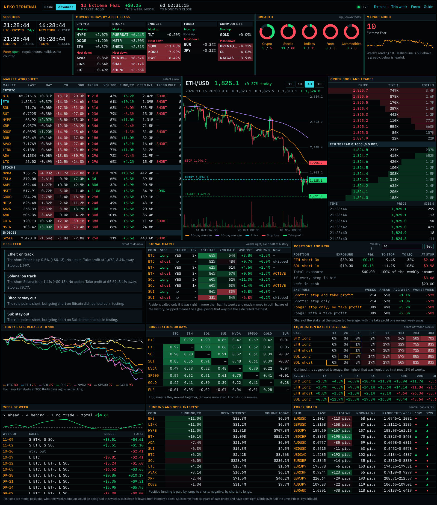
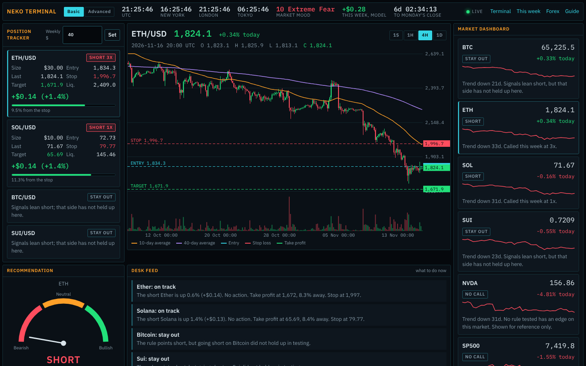
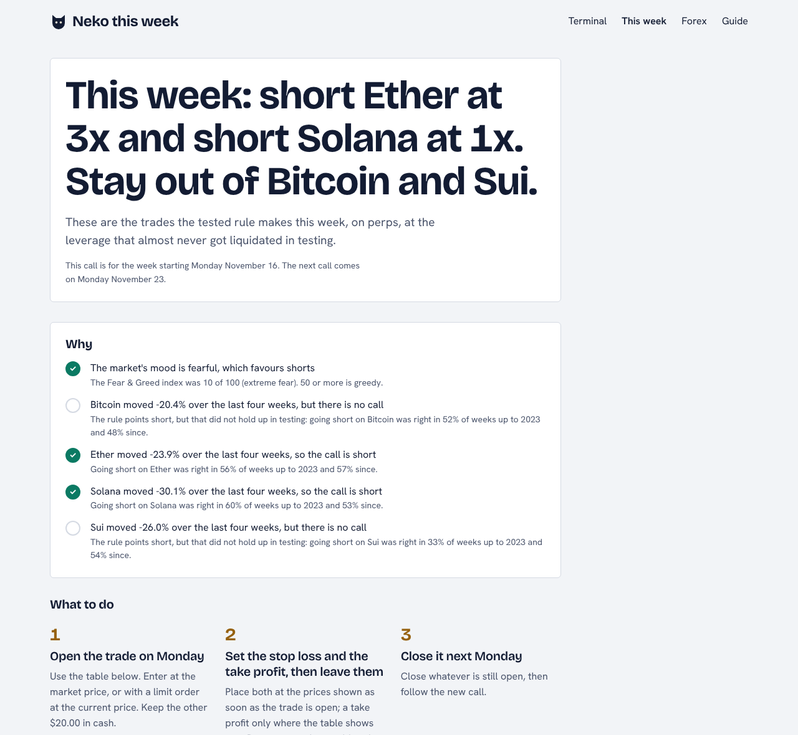
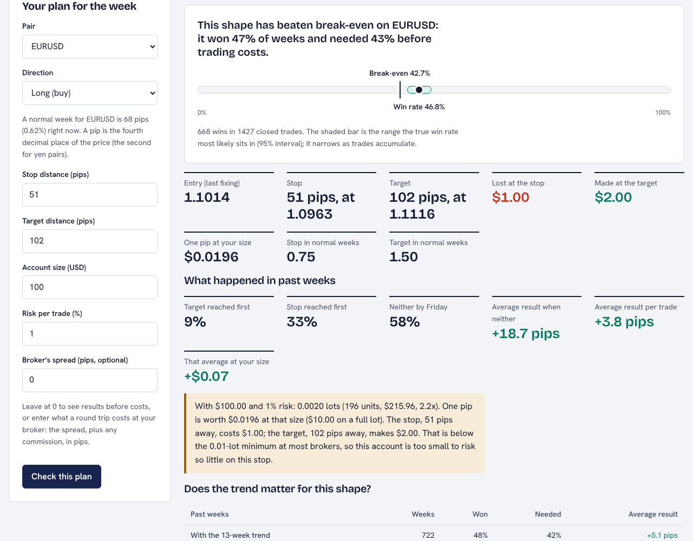
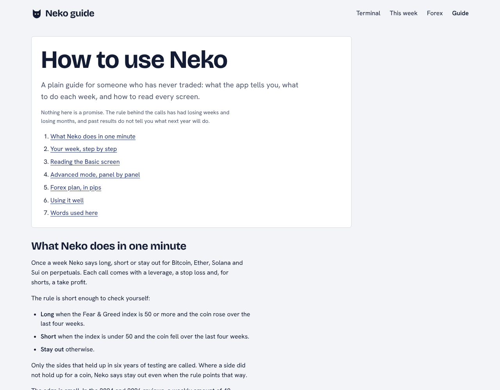
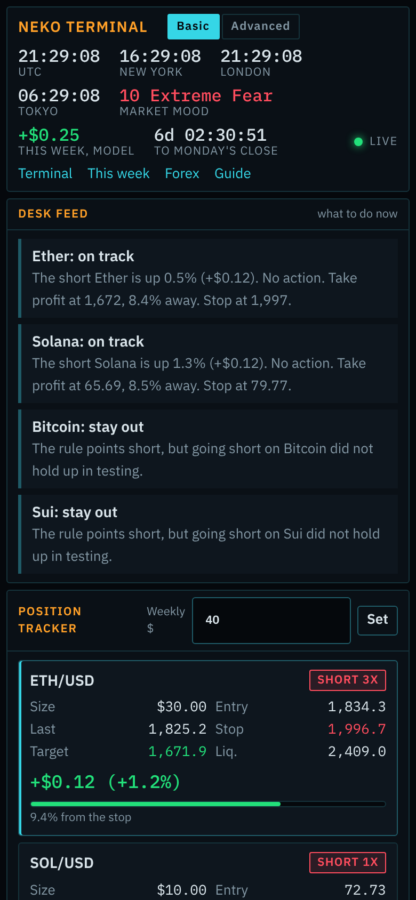

<div align="center">

# Neko

**A weekly crypto call and a live market terminal, built on rules that were tested before they were trusted.**

</div>



Neko answers one question for someone who does not trade for a living:
**this week, long, short or stay out?** It makes that call once a week for
Bitcoin, Ether, Solana and Sui on perpetuals, with a suggested leverage, a
stop loss and, for shorts, a take profit. A live terminal then follows the
week and says in plain words what to do now.

Nothing in it is a promise of profit. Every rule was replayed on years of
past prices with fees, most ideas failed and were thrown out, and the edge
that is left is small. The numbers are below.

## What it does

- **The week's call.** Long when the Fear & Greed index is 50 or more and the
  coin rose over the last four weeks; short when it is under 50 and the coin
  fell; otherwise stay out. Only the sides that held up in testing are called.
- **An order ticket.** Position size, leverage, entry, stop loss and take
  profit for the amount you set aside each week, and a warning when a trade is
  too small for the exchange to accept.
- **A live terminal.** Model positions, a candle chart down to one-second
  candles, an order book and trade tape, and a feed that says when a stop or a
  take profit was hit. The Advanced screen adds a 30-market heat map, movers,
  breadth, correlations, risk and the tested record of every rule.
- **A forex planner, in pips.** Neko does not pick a forex direction, because
  nothing tested could. You bring the idea; it shows how that stop and target
  have done since 1999 and how big to trade.
- **A plain-language guide** to the weekly routine and every screen.

## Screens

| | |
|---|---|
|  **Terminal, Basic.** Positions, chart, market dashboard and the "what to do now" feed. |  **This week.** The call, why, the steps and the order ticket. |
|  **Forex plan.** A stop and target in pips, checked against 27 years of weeks. |  **Guide.** How to use it, for someone who has never traded. |

<p align="center"></p>

## What the tests found

Everything here can be re-run from `research/scripts/`; the write-up is in
[`docs/web/README.md`](docs/web/README.md).

| Question | Result |
|---|---|
| Does the weekly rule work on both sides? | Only on some. Long Bitcoin, long and short Ether and long and short Solana were right more than half the time and profitable in both halves of six years. Short Bitcoin and both sides of Sui were not, so they are never called. |
| How much leverage? | 3x on Bitcoin and Ether, 2x or 1x on Solana: the highest that was wiped out in at most 1 week in 50. At 10x the same trades were liquidated in 16% to 57% of weeks. |
| Where should the stop go? | One "normal week" from the entry. Tighter stops were hit by ordinary swings and cut the average by a third to a half. |
| Take profit? | On shorts, one normal week away: reached in 31% of short weeks, with no loss of average. On longs, none: not one of the 83 plans tested was as good as the stop alone. |
| A whole year, 40 dollars a week | 2024, a rising market: +14.34 dollars, 18 winning weeks and 24 losing, and less than simply holding. 2026 so far, a falling market: +9.68 dollars, 17 winning weeks and 13 losing. |
| Forex direction | 14 price rules and 9 positioning rules on 14 pairs over 27 years. None beat a coin flip after costs. |
| Gold | 28 rule versions on seven years of weekly prices. None beat simply holding gold. |
| Letting an AI model pick the trades | The original engine, with a model choosing trades, won about 35% of the time where it needed about 52% to break even. It is not used for calls. |

Those two years are part of the history the rules were chosen from, so they
describe the rules rather than prove them.

## Run it

### Neko Lite (TypeScript, no server)

The terminal, the week's call, the forex planner and the guide as a static
site. The pages work everything out in the browser from public market data.

```bash
cd neko-lite
npm install
npm run dev        # http://localhost:5173
```

To put it online, import this repository in Vercel and set **Root Directory**
to `neko-lite`. No environment variables are needed. More in
[`neko-lite/README.md`](neko-lite/README.md).

### The full Python app

Everything in Neko Lite, plus a watchlist desk with paper trading, paper bots
with goals and a daily email, and a public track-record page. It needs one
setting, a sign-in password.

```bash
python3 -m venv .venv
.venv/bin/python -m pip install -r service/requirements.txt
NEKO_PASSWORD='a long password' .venv/bin/python service/start_web.py   # http://localhost:8000
```

Or build the default `Dockerfile`, set `NEKO_PASSWORD`, and mount a volume at
`/data`.

| Page | What it is for |
|---|---|
| `/terminal` | The live terminal, Basic and Advanced |
| `/week` | The week's calls, the order ticket and a week-by-week scoreboard |
| `/weekly` | The forex planner, in pips |
| `/desk` | Signals for a watchlist across crypto, stocks, forex and commodities, paper-traded |
| `/console` | Paper bots, goals and the daily email |
| `/` | Public paper-trading record |

## How it is kept honest

- **Tested before shipped.** A rule goes into the app only after it has been
  replayed on past data with fees, and only if it held up in both halves of
  the history.
- **Two versions, one set of numbers.** Neko Lite is checked against the
  Python app value by value on recorded market data: about 9,700 values, none
  differing.
- **Automated tests** on both sides:

```bash
.venv/bin/python -m pytest service/server/tests/test_web.py service/server/tests/test_desk.py \
  service/server/tests/test_forex_weekly.py service/server/tests/test_terminal.py \
  service/server/tests/test_terminal_adv.py tests/execution/test_trend_agent.py -q
cd neko-lite && npm test
```

## Where the data comes from

| Data | Source |
|---|---|
| Prices, candles, order book, trades, funding | Hyperliquid's public API and stream |
| Market mood | alternative.me Fear & Greed index |
| Forex rates | European Central Bank daily reference rates |
| Gold history for the test | Kraken's public API (PAXG) |

## What is in the repository

- `neko-lite/` the TypeScript app (`src/core` calculations, `src/ui` screens, `api/fx.ts` the one server function)
- `service/server/` the Python web app and its tests
- `web/` the Python app's screens
- `research/scripts/` every test behind the findings above; results in `research/exports/tables/`
- `docs/web/README.md` the full write-up of the web app and the research
- `docs/legacy-stack.md` the older Telegram bot network, paper-trading API and execution gateway that this repository also contains

## Disclaimer

This is not financial advice. The calls come from rules fitted to past
prices; they have had losing weeks, losing months and stretches of five
months under water, and the past does not tell you what next year will do.
Leverage can liquidate a position. Only use money you can afford to lose.

---

<div align="center"><sub>MIT licensed</sub></div>
